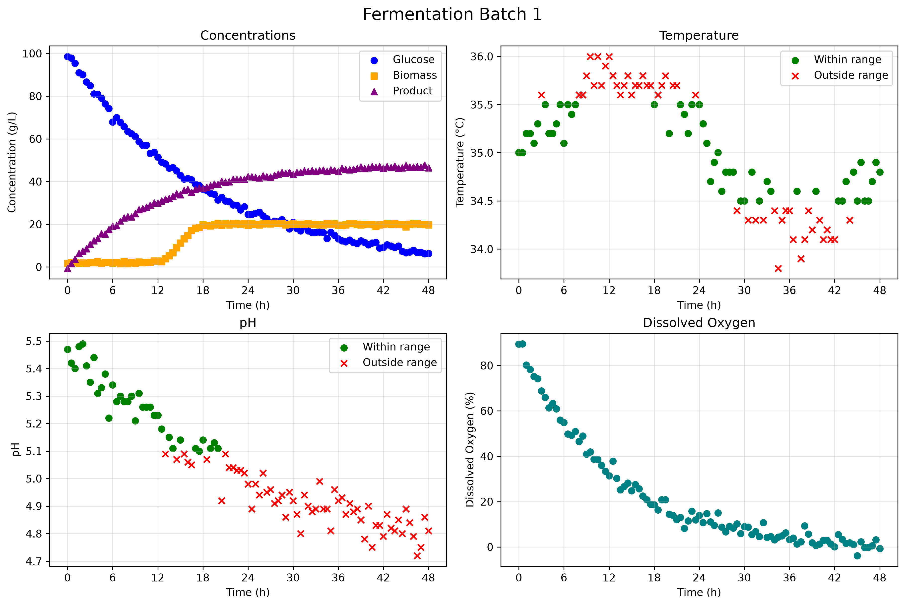

# Monitoring A Fermentation Batch

A monitoring system that is Python based and that evaluates fermentation batch data. It also automatically produces process dashboards and summary tables.

## Overview

The purpose of this project is to monitor simulated fermentation processes and to identify if important operating variables stay under acceptable ranges. For different fermentation batches, the program analyzes pH and temperature measurements entation batches. It produces visual dashboards and batch-level performance summaries.

## Features

The custom `BioprocessMonitor` Python class can:

- Import fermentation process data from a CSV file.
- Extract measurements associated with a particular batch.
- Determine whether pH measurements are within an acceptable operating range.
- Determine whether temperature measurements are within an acceptable operating range.
- Count the number of batches contained in the dataset.
- Generate a four-panel dashboard for each fermentation batch.
- Export summary tables describing the performance of every batch.
- Analyze the process using two different operating modes.

## Technologies Used

- Python 3.14.7
- pandas 3.0.5
- Matplotlib 3.11.0

## Code Design

The program is organized around the `BioprocessMonitor` class located in `src/classes.py`. When `main.py` is executed, it creates two monitoring configurations called Mode A and Mode B. Each mode has its own acceptable pH and temperature limits.

For every mode, the program reads the fermentation dataset, determines the number of batches, and generates a dashboard for each batch. It then creates a summary CSV file containing the percentage of acceptable pH and temperature measurements and the final product concentration for every batch.

The generated dashboard images are saved in the `figures` directory, while the generated summary tables are saved in the `tables` directory.

## Dashboard

The following dashboard presents the monitoring results for Batch 1 under Mode B:

The top-left graph displays glucose, biomass, and product concentrations as functions of time. The top-right graph displays temperature measurements, while the bottom-left graph displays pH measurements. Green circles represent measurements within the acceptable operating range, and red X markers represent measurements outside that range. The bottom-right graph shows the dissolved oxygen percentage throughout the fermentation process.

## Summary Table

The following table summarizes the fermentation batches under Mode A:

| batch_id | ph_optimal_percent | temperature_optimal_percent | C_product_g_L^-1_final |
|---:|---:|---:|---:|
| 1 | 93.81 | 97.94 | 46.5 |
| 2 | 96.69 | 97.52 | 50.8 |
| 3 | 95.89 | 93.15 | 44.6 |
| 4 | 100.00 | 96.47 | 48.6 |
| 5 | 48.62 | 99.08 | 24.7 |

The `ph_optimal_percent` and `temperature_optimal_percent` columns indicate the percentage of measurements that remained within the Mode A acceptable operating ranges. The final column reports the final product concentration for each fermentation batch in grams per litre.